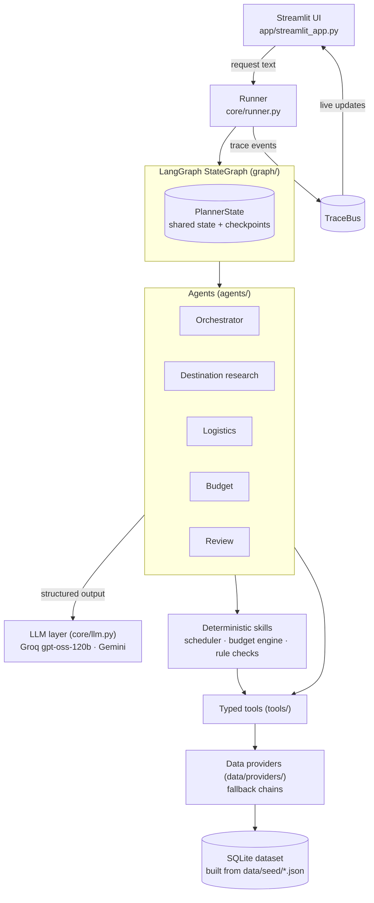
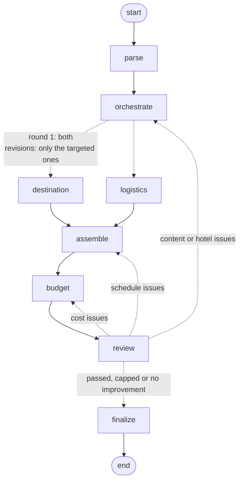

# Dubai AI Travel Planner

A multi-agent system built with **LangGraph** that turns a plain-English travel request into a
personalised, budget-aware and validated Dubai itinerary.

> *"Plan a 4-day trip to Dubai with a budget of AED 5,000, excluding flights. I enjoy cultural
> attractions, local food, and beaches. I prefer affordable hotels and want to avoid crowded
> places."*

Five specialised agents research places, choose a hotel area, build a day-by-day schedule, cost
it and review it. When the review finds a problem (over budget, a crowded place, too much time
in taxis), the graph sends it back to the agent responsible, and only that agent re-runs. A
Streamlit UI shows the agents working live, the graph, the itinerary on a map, the budget and
how each revision changed the plan.

- **Free and open data only:** OpenStreetMap, OSRM routes, official RTA fares, Open-Meteo, and a
  curated dataset. The LLM is the only paid dependency.
- **Runs fully offline:** without API keys, every agent falls back to deterministic code, so
  runs are free and reproducible.
- **Numbers come from code, not the LLM:** times, routes, prices and budget maths are
  computed in Python. The LLMs rank, choose and explain.
- **Every value has a source:** prices, fares and travel times are tagged `verified`, `api` or
  `estimated`, and the UI shows the tag.

> **Status:** Phases 0-7 of the [implementation plan](docs/implementation-plan.md) are done:
> contracts, dataset, deterministic skills, agents, LangGraph orchestration, the Streamlit UI
> and free live data. Next: hardening and the demo (Phase 8).

---

## Architecture



| Layer | Folder | Role |
| --- | --- | --- |
| UI | `app/` | Streamlit page; runs the graph in a worker thread and polls the `TraceBus` |
| Runner | `core/runner.py` | `run(text) -> RunResult`; streams the graph and collects metrics |
| Graph | `graph/` | State, nodes, routing and the compiled `StateGraph` with a checkpointer |
| Agents | `agents/` | Five agents, their prompts and the deterministic skills |
| LLM | `core/llm.py` | Per-agent model and provider, structured output with one retry |
| Tools | `tools/` | Typed functions the agents call (search, travel time, fares, prices, weather) |
| Data | `data/` | Curated seed JSON, SQLite build, providers with fallback chains |
| Contracts | `schemas/` | Pydantic models shared by everything, each value with its provenance |

The full design is in [docs/architecture.md](docs/architecture.md).

### The graph



1. **parse:** the Orchestrator turns the text into a `TripRequest` (days, AED budget, interests,
   hotel tier, things to avoid, diet) and records every assumption it had to make.
2. **orchestrate → destination ∥ logistics:** both run in the **same superstep** (in parallel).
3. **assemble:** the Orchestrator builds the day-by-day plan with the scheduler.
4. **budget:** costs every slot. On a revision round, it also applies cheaper alternatives.
5. **review:** rule checks first (authoritative), then the LLM adds qualitative comments.
6. **Routing:** each issue names the node that must fix it. Only those nodes re-run, and their
   prompts receive the issues as revision feedback. The loop stops when the plan passes, after
   `MAX_REVISIONS` (default 3), or when the same issues come back twice in a row. In the last
   two cases, `finalize` returns the best-scoring draft and lists what is unresolved.

The generated diagram (`uv run python -m graph.build`) is in [docs/graph.mmd](docs/graph.mmd).

**LangGraph features used:** shared typed state with `add` reducers, parallel fan-out,
conditional edges, a bounded feedback loop, a checkpointer (every superstep is stored, so the
UI can replay it and diff drafts), runtime context for non-data dependencies, and streaming
(`stream_mode=["updates", "custom"]`).

---

## The agents

| Agent | Model (default) | What the LLM does | What code does | Without an LLM |
| --- | --- | --- | --- | --- |
| **Orchestrator** | Groq `openai/gpt-oss-120b` (temp 0.0 for parsing, 0.6 for day themes) | Parses the request into structured constraints; writes day themes | Normalises the request (Dubai only, 1-7 days, currency conversion, defaults); builds the schedule with the scheduler | Keyword parser; the scheduler's own day themes |
| **Destination research** | Groq `openai/gpt-oss-120b` (temp 0.3) | Ranks attractions and restaurants against the interests and "avoid" list, with one-line reasons | Searches the dataset, drops ids the LLM invented, flags interests with little data, excludes places Review rejected | Ranks by interest match × crowd penalty × quality |
| **Logistics** | Groq `openai/gpt-oss-120b` (temp 0.3) | Ranks hotel areas for the tier and explains transport trade-offs | Seasonal hotel prices, RTA fares, travel-time matrix; puts an area Review blamed last | Ranks by metro access, then centrality, then price (price first when the hotel is the cost driver) |
| **Budget** | Groq `openai/gpt-oss-120b` (temp 0.2) | Chooses among cheaper alternatives (no arithmetic) | Costs everything; measures each alternative's saving by re-planning; rejects alternatives that break another rule; prefers the requested hotel tier | Applies the biggest same-tier saving first |
| **Review** | Gemini `gemini-3.5-flash-lite` (temp 0.2) | Adds up to 5 qualitative comments (variety, pacing, fit); these are always minor | 19 rule checks, each with a severity and the agent to route to; score and pass/fail | Rule checks only |

The reviewer uses a different model family on purpose: a second model checks the first one's
work. Any agent can use any provider through configuration (see [Configuration](#configuration)).

**Rules Review checks** (each one names the node that must fix it):

| Severity | Rules → routed to |
| --- | --- |
| Blocker | over budget → Budget; day overloaded, outside opening hours → Assemble; closed for the season, unknown place → Destination |
| Major | hotel is the cost driver, leg longer than 60 min → Logistics; day transit over 2.5 h → Assemble (or Logistics when the hotel is far); duplicate place, crowded place when avoiding crowds, missing interest → Destination |
| Minor | missing meal, missing leg, repeated restaurant, outdoor midday heat, early start, late finish, diet not met → Assemble; no budget yet → Budget |

A plan passes when there are no blockers and no majors. Score = 100 − 30 per blocker − 12 per
major − 3 per minor.

**Example runs (offline, no LLM):**

- **The example request:** passes first time. 4 days, budget hotel area, about AED 2,690 of
  5,000, score 100.
- **"4 days, mid-range hotel, budget AED 3000, culture and beaches, avoid crowds":** the first
  draft costs AED 4,354.
  - Review raises *over_budget* (blocker → Budget) and *hotel_cost_driver* (major → Logistics).
  - Only Logistics and Budget re-run; Destination does not.
  - The revised plan moves to a budget hotel area: AED 2,433, score 100, after 1 revision.

---

## Data

| Data | Source | Provenance |
| --- | --- | --- |
| 21 neighbourhoods, 50 attractions, 62 restaurants | Curated; 109 of 112 places matched to OpenStreetMap (Overpass) | `verified` (with OSM link) where matched |
| 17 hotel areas (area × tier) with seasonal multipliers | Curated typical ranges; Tourism Dirham, service charge, VAT | `estimated` |
| Metro, bus, abra fares; taxi tariffs | RTA and Dubai Taxi official tables | `verified` |
| Driving and walking times between every curated point (~17,500 routes each) | OSRM on OpenStreetMap, fetched once; plus taxi pickup and a city-traffic factor | `estimated` |
| Metro and abra times | Heuristic (no open RTA timetable feed) | `estimated` |
| Monthly climate | Open-Meteo climate normals | `verified` |

**Live data** (`DATA_MODE`):
- **`local`** (the default) is fully offline.
- **`hybrid`** adds live sources within a per-run budget of network calls:
  - OpenStreetMap places via Overpass;
  - Open-Meteo forecasts for trips in the next 16 days;
  - live OSRM routes for those places.
- **`live`** routes every taxi and walking leg with OSRM.

Live values are tagged `api`. If a live source fails, the plan falls back to the curated data,
and the failure shows in the trace.

The SQLite database is built from `data/seed/*.json` on first run (it is not committed).
Details and refresh commands: [data/README.md](data/README.md). Source research:
[docs/research.md](docs/research.md).

---

## Quick start

Requirements: Python 3.11+ and [uv](https://docs.astral.sh/uv/).

```bash
git clone git@github.com:vikramragu/dubai-ai-travel-planner.git
cd dubai-ai-travel-planner
uv sync                      # create .venv and install everything
cp .env.example .env         # then add your API keys (optional)
```

**Run the UI**

```bash
uv run streamlit run app/streamlit_app.py
```

1. Type a request; the example is pre-filled.
2. Pick **Configured LLMs**, or **No LLM** to run offline.
3. Press **Plan my trip**.

While the plan is being built, you see each agent's status and the active graph node.
Afterwards there are tabs for:

- the itinerary, with a route map per day and source badges;
- the budget, against your limit;
- each review round, with the draft-to-draft diff;
- the agent timeline;
- a replay of the graph's checkpoints;
- run metrics.

**Run from the command line**

```bash
uv run python -m core.runner "4 days in Dubai, budget AED 3000, culture and beaches"
uv run python -m core.runner --no-llm      # the example request, offline
```

**API keys** (both free tiers work):

| Key | Used by | Get one |
| --- | --- | --- |
| `GROQ_API_KEY` | Orchestrator, Destination, Logistics, Budget | https://console.groq.com/keys |
| `GOOGLE_API_KEY` | Review (Gemini; `GEMINI_API_KEY` also works) | https://aistudio.google.com/apikey |

With real models, the example request takes about 20 seconds and the over-budget request (one
revision) about 35 seconds, both within the free tiers: prompts send places as compact tables,
so a run uses roughly 5,000-10,000 input tokens.

If an agent's key is missing, that agent uses its deterministic fallback and the others still use
their LLM. LLM errors (timeouts, invalid output after one retry) also fall back, so a run never
fails because of the LLM.

---

## Configuration

Settings are read from environment variables or `.env` (see [.env.example](.env.example)).

| Variable | Default | Meaning |
| --- | --- | --- |
| `LLM_PROVIDER` / `LLM_MODEL` | `groq` / `openai/gpt-oss-120b` | Default model for all agents |
| `LLM_PROVIDER_REVIEW` / `LLM_MODEL_REVIEW` | `google_genai` / `gemini-3.5-flash-lite` | Model for the review agent |
| `LLM_PROVIDER_<ROLE>` / `LLM_MODEL_<ROLE>` | — | Per-agent override: `ORCHESTRATOR`, `DESTINATION`, `LOGISTICS`, `BUDGET`, `REVIEW` |
| `GROQ_API_KEY`, `GOOGLE_API_KEY` | — | Provider keys (Anthropic and OpenAI keys are also supported) |
| `DATA_MODE` | `local` | `local` (offline dataset), `hybrid` or `live` (free live sources, local fallback) |
| `EXTERNAL_CALL_BUDGET` | `40` | Max network calls per run in hybrid mode (cache hits are free) |
| `OSRM_CAR_URL` / `OSRM_FOOT_URL` | public OSRM servers | Routing servers (self-hosted OSRM works too) |
| `LLM_TIMEOUT_S` / `LLM_MAX_RETRIES` | `60` / `2` | Per-call limits; past them the agent falls back instead of stalling |
| `LLM_MAX_TOKENS` / `LLM_REASONING_EFFORT` | `1500` / `low` | Groq output cap and gpt-oss reasoning effort (both count towards Groq's tokens-per-minute limit) |
| `MAX_REVISIONS` | `3` | Cap on the review loop |
| `CONTINGENCY_PCT` | `10` | Buffer added to estimated prices |

Providers are created with LangChain's `init_chat_model("provider:model")`. Switching a model
or provider is a configuration change; no code changes are needed. Other providers are
optional extras: `uv sync --extra openai` or `uv sync --extra ollama`.

---

## Development

```bash
uv run pytest                # tests (the real-LLM test runs only when both keys are set)
uv run pytest -m llm         # the real-LLM smoke test
uv run pytest --cov          # with coverage
uv run ruff check .          # lint
uv run ruff format .         # format
uv run mypy                  # type check (strict)
```

Other useful commands:

```bash
uv run python -m graph.build              # regenerate docs/graph.mmd
uv run python -m agents.skills.scripted   # the deterministic planner alone (no agents)
uv run python -m data.build_db            # rebuild the SQLite dataset from data/seed/
uv run python -m schemas.export build/schemas   # export the JSON schemas
```

- **Tests** cover the schemas, the dataset, the providers and tools, and the agents (with a
  stubbed LLM).
- The scheduler and budget engine have property tests with Hypothesis.
- Graph tests check the parallel superstep, routing for each issue type, loop termination and
  the checkpoint history.
- UI tests use Streamlit's `AppTest` to run the app headlessly.
- **CI** (GitHub Actions) runs lint, format check, type check and tests on every push and pull
  request.
- **Pre-commit hooks are optional.** [.pre-commit-config.yaml](.pre-commit-config.yaml) runs
  ruff and mypy before each commit if you enable it with `uv run pre-commit install`. CI runs
  the same checks, so it isn't required.

## Project layout

```
app/        Streamlit UI: page, run handle (worker thread), components
core/       config, LLM layer, runner, trace events and TraceBus
graph/      LangGraph state, nodes, routing, graph build
agents/     the five agents, prompts (agents/prompts/), deterministic skills (agents/skills/)
tools/      typed tool functions and compact views for the LLM
schemas/    shared Pydantic contracts with provenance
data/       curated seed data, OSM exports, build scripts, providers
tests/      unit, graph and (Phase 8) scenario tests
docs/       problem statement, architecture, data research, implementation plan
```

## Limitations

- Prices are estimates from curated and open data, and nothing is booked. The UI says so.
- Hotel prices are per area and tier, not per named hotel.
- Travel times come from OSRM routes without live traffic (a fixed city-traffic factor is
  applied); metro times are estimates.
- Dubai only, 1-7 days, no flights.
